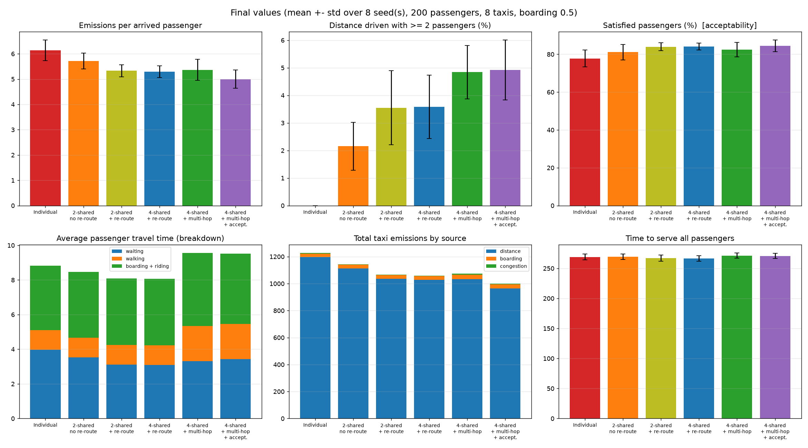
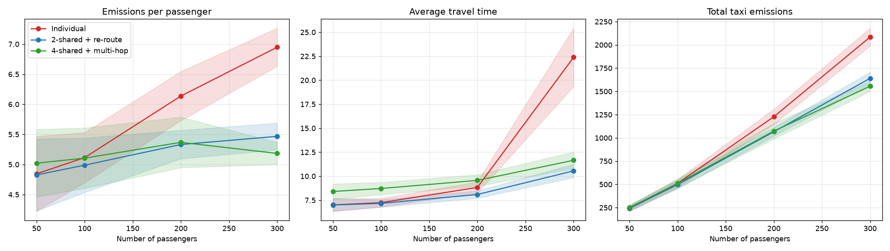
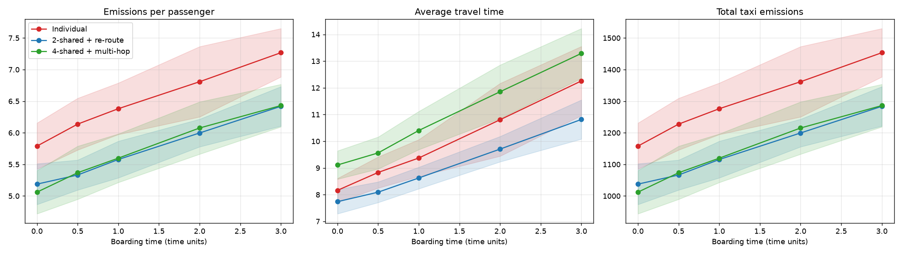

# Shared Multi-City Taxi Simulation

A multi-agent simulation of a **taxi carshare service**, built with [Mesa](https://mesa.readthedocs.io/) (Python).
Passengers and taxis are autonomous agents that negotiate rides through a message-based **Contract Net protocol**.
The simulation measures how ride sharing, route changes and multi-hop journeys affect **traffic, travel time, pollution and acceptability**.

> Course project – *Foundations of Agent-based Systems*, M1 DKAI, Université Paris-Saclay
> Students: **Evan Bernier**, **Umair Ahmed** · Professor: **Nicolas Sabouret**

The full report is in [`report/Carshare_Taxi_Simulation_Report.pdf`](report/Carshare_Taxi_Simulation_Report.pdf).

---

## Table of contents

- [Research question](#research-question)
- [Installation](#installation)
- [Quick start](#quick-start)
- [Command-line options](#command-line-options)
- [How the simulation works](#how-the-simulation-works)
- [Project structure](#project-structure)
- [Outputs](#outputs)
- [Results](#results)
- [Limitations](#limitations)

---

## Research question

*Does sharing taxis reduce pollution and congestion without making trips unacceptable for passengers?*

The project follows an incremental design. Each configuration adds one feature to the previous one:

| # | Configuration | Shared | Capacity | Re-route | Multi-hop | Acceptability |
|---|---|:-:|:-:|:-:|:-:|:-:|
| 1 | Individual | ✗ | 1 | – | ✗ | ✗ |
| 2 | 2-shared, no re-route | ✓ | 2 | ✗ | ✗ | ✗ |
| 3 | 2-shared + re-route | ✓ | 2 | ✓ | ✗ | ✗ |
| 4 | 4-shared + re-route | ✓ | 4 | ✓ | ✗ | ✗ |
| 5 | 4-shared + multi-hop | ✓ | 4 | ✓ | ✓ | ✗ |
| 6 | 4-shared + multi-hop + accept. | ✓ | 4 | ✓ | ✓ | ✓ |

---

## Installation

Requires **Python 3.12+** (needed by Mesa 3.5).

```bash
git clone https://github.com/umairahmed786/carshare-taxi-simulation.git
cd carshare-taxi-simulation
python3 -m venv venv
source venv/bin/activate          # Windows: venv\Scripts\activate
pip install -r requirements.txt
```

Dependencies: `mesa>=3.2,<4` (tested with 3.5), `numpy`, `pandas`, `matplotlib`.

---

## Quick start

Everything runs from a single file, `run.py`.

**Full study.** With no arguments, `run.py` runs all 6 configurations, plus the boarding-time and demand sweeps, and saves the comparison figures:

```bash
python run.py
```

**One configuration.** Pass policy flags to run a single setup:

```bash
# individual taxis (no sharing)
python run.py --no-shared

# 2 passengers per taxi, no route change, no multi-hop
python run.py --capacity 2 --no-reroute --no-multi-hop

# 4 passengers per taxi, re-routing, multi-hop, acceptability filter
python run.py --capacity 4 --reroute --multi-hop --acceptability

# bigger scenario, more seeds, custom output folder
python run.py --passengers 300 --taxis 10 --seeds 12 --out results_300
```

Each run prints a one-line summary per configuration (mean over the seeds) and writes CSV tables and PNG figures to the output folder.

---

## Command-line options

| Option | Default | Description |
|---|---|---|
| **Taxi policy** | | |
| `--shared / --no-shared` | shared | Individual taxis, or a carshare |
| `--capacity {1,2,3,4}` | `4` | Passengers allowed on board at once (forced to 1 when not shared) |
| `--reroute / --no-reroute` | on | A taxi may insert a new pickup *before* its current next stop |
| `--multi-hop / --no-multi-hop` | on | Inter-city trips go through hubs (local taxi → hub-to-hub taxi → local taxi) |
| `--acceptability / --no-acceptability` | off | Passengers refuse offers with long waits, detours or too many transfers |
| **Scenario** | | |
| `--passengers` | `200` | Number of passengers (demand) |
| `--taxis` | `8` | Number of taxis |
| `--cities` | `4` | Number of cities, laid out in a square-ish grid (each 4×4 districts) |
| `--inter-city-prob` | `0.3` | Probability that a trip goes to another city |
| `--boarding-time` | `0.5` | Time units per boarding / alighting |
| `--horizon` | `250` | Requests are spread over `[0, horizon]` |
| **Experiment** | | |
| `--seeds` | `8` | Number of runs (seeds 1..N) averaged |
| `--max-steps` | `2000` | Safety limit on the number of steps |
| `--compare` | – | Force the full study (default when no argument is given) |
| `--out` | `results` | Output directory |
| `--no-plot` | – | Only print and save the tables |

Run `python run.py --help` for the full list.

---

## How the simulation works

### Environment

- A Mesa `MultiGrid`. With 4 cities it is **12×12**: four 4×4 cities separated by gaps. Each city has a **hub** cell (`(1,1)`, `(9,1)`, `(1,9)`, `(9,9)`).
- Taxis drive in **continuous space** (Euclidean distance) with a time budget per step, so pickup and drop-off times are exact.
- **Walking** is only possible inside a city. Orthogonal moves cost 2×, diagonal moves 0.5× (shortest path with Dijkstra). A passenger walks if the trip takes at most `walk_max_time = 2.5`.

### Passenger demand

All passengers are created once at setup with a dedicated random generator seeded by the run's seed. Every configuration therefore faces **exactly the same demand** for a given seed, and the comparison is fair. Each passenger has a random origin, destination (inter-city with probability 0.3) and request time.

### Journey planning

- **Same city:** walk if short enough, otherwise one taxi leg.
- **Different city, no multi-hop:** one direct taxi.
- **Different city, multi-hop:** local leg to the hub → hub-to-hub taxi → local leg from the hub (each local leg walked or by taxi).

### Agents and the Contract Net protocol

Every agent follows the cycle **check mailbox → perceive → deliberate → act**.

```
Passenger                        Taxi(s)
    | ---- CFP (pickup, dropoff) ---> |
    | <--- PROPOSE (eta, cost) ------ |   or REFUSE
    | ---- ACCEPT  -----------------> |   (others get REJECT)
    | <--- CONFIRM ------------------ |   or FAILURE → new round
```

- **Passenger:** sends a call for proposals to the taxis, picks the offer with the earliest arrival (then the smallest added cost), waits, boards, rides and alights. It retries after a delay if no taxi can take it.
- **Taxi:** plans its route with **cheapest insertion**. It tries every position for the new pickup and drop-off, checks capacity and the maximum detour (`max_detour = 3`) for passengers already on board, and proposes the cheapest feasible plan. With `--no-reroute`, the new stops can only be added after the current next stop.

### Traffic, emissions and acceptability

- **Congestion:** taxi speed = `1 / (1 + α·n)`, where `n` is the number of other moving taxis in the same cell and `α = 0.3`.
- **Emissions** = distance × 1 + boardings × 0.5 + congestion delay × 0.5.
- **Acceptability** (always measured; used to refuse offers only with `--acceptability`): wait ≤ 8, ride stretch ≤ 1.6 × the direct ride, transfers ≤ 1.

### Step order

At each step, passengers act in random order, then taxis act in random order. Simulation time then advances by `dt = 1` and the `DataCollector` records the metrics. A run stops when every passenger has arrived, or after `--max-steps` steps.

---

## Project structure

```
carshare-taxi-simulation/
├── run.py            # single entry point: CLI, experiments, sweeps, plots
├── model.py          # TaxiModel: grid, cities, hubs, demand, journey planning, data collection
├── agents.py         # CommAgent, Passenger and Taxi agents (decision logic, route insertion, driving)
├── messages.py       # Contract Net performatives and the Message class
├── requirements.txt
├── results/          # figures and CSV tables produced by run.py
└── report/           # project report (PDF)
```

---

## Outputs

All files are written to `--out` (default `results/`).

| File | Content |
|---|---|
| `summary.csv` | Final metrics per configuration (mean over seeds) |
| `timeseries.csv` | Metrics over time |
| `fig_configs.png` | Six-panel comparison of the configurations (full study) |
| `fig_breakdown.png` | Breakdown of travel time and emissions (full study) |
| `fig_timeseries.png` | Evolution of the metrics over time (full study) |
| `sweep_boarding.csv`, `fig_boarding.png` | Sensitivity to the boarding time (0 → 3) |
| `sweep_passengers.csv`, `fig_passengers.png` | Sensitivity to demand (50 → 300 passengers) |
| `timeseries.png`, `summary.png` | Figures for a single-configuration run |

Measured metrics include completion rate, average travel and waiting time, total emissions and emissions per passenger, mean occupancy, share of distance driven shared, congestion delay, number of messages and the share of satisfied passengers.

---

## Results

Default scenario: 4 cities, 8 taxis, 200 passengers, mean over 8 seeds. All configurations reach 100% completion.

| Metric | Individual | 2-sh. no RR | 2-sh. + RR | 4-sh. + RR | 4-sh. + MH | MH + accept. |
|---|---|---|---|---|---|---|
| Avg. travel time | 8.83 | 8.47 | 8.09 | 8.07 | 9.56 | 9.52 |
| Emissions / passenger | 6.14 | 5.71 | 5.33 | 5.29 | 5.37 | **5.00** |
| Total emissions | 1227 | 1143 | 1066 | 1058 | 1074 | **1000** |
| Satisfied passengers (%) | 77.8 | 81.1 | 84.0 | 84.1 | 82.5 | **84.4** |

**Key findings**

- Sharing with re-routing cuts emissions per passenger by about **13%**, and by about **19%** with the acceptability filter.
- The gain comes mostly from **less empty driving**: a nearby busy taxi picks the passenger up on its way, instead of a distant free taxi crossing the city. The share of distance driven with 2+ passengers stays low (2–5%).
- Multi-hop adds transfers and hub congestion, so travel time goes up. It only pays off when combined with the acceptability filter.
- Under **high demand** (300 passengers), individual taxis are overwhelmed: travel time is 22.4 vs about 11 with sharing, and total emissions are 21–25% lower with sharing. Under low demand, all configurations perform about the same.

<p align="center">
  <br>
  <br>
  
</p>

See the [report](report/Carshare_Taxi_Simulation_Report.pdf) for the full analysis.

---

## Limitations

- Abstract grid instead of a real road network. Congestion is modelled per cell.
- Demand is uniform and random, with no peak hours or hot spots.
- Taxis do not reposition themselves when idle, and there is no pricing model.
- Parameters such as emission weights and acceptability thresholds are illustrative, not calibrated on real data.
